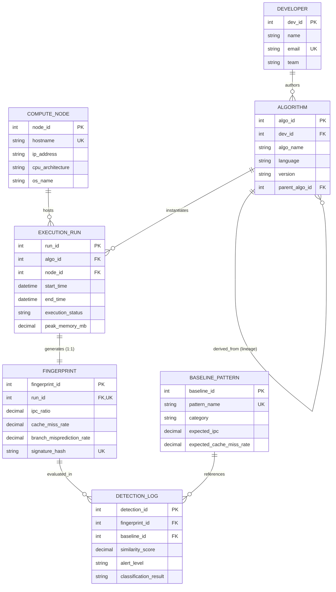

# MINI PROJECT REPORT

## ALGORITHMIC EXECUTION FINGERPRINTING AND RUNTIME THREAT DETECTION SYSTEM

**Course:** UE23CS351A / UE24CS351A – Database Management Systems  
**Department:** Department of Computer Science and Engineering  
**Institution:** PES University, Bengaluru – 560 100, Karnataka, India  
**Academic Period:** AUG – DEC 2026  

---

### Submitted By:
| Student Name | SRN | Roll No. |
| :--- | :--- | :--- |
| **Sanyam Deven Hiran** | PES2UG24CS446 | Group 20 |
| **Shashank A** | PES2UG24CS461 | Group 20 |

### Under the Guidance of:
**Dr. Shilpa S**  
Assistant Professor  
Department of Computer Science and Engineering  
PES University, Bengaluru  

---

## CERTIFICATE

This is to certify that the mini-project entitled **"Algorithmic Execution Fingerprinting and Runtime Threat Detection System"** is a bonafide work carried out by:
- **Sanyam Deven Hiran (PES2UG24CS446)**
- **Shashank A (PES2UG24CS461)**

in partial fulfilment for the completion of the fifth semester **DBMS Project (UE23CS351A / UE24CS351A)** in the Program of Study – *Bachelor of Technology in Computer Science and Engineering* under the rules and regulations of PES University, Bengaluru during the period **AUG. 2026 – DEC. 2026**.

It is certified that all corrections and suggestions indicated for internal assessment have been incorporated into this report. The project has been approved as it satisfies the 5th semester academic requirements in respect of project work.

<br/><br/>
___________________________  
**Dr. Shilpa S**  
Assistant Professor, Dept. of CSE  
PES University, Bengaluru  

---

## DECLARATION

We hereby declare that the DBMS Mini Project entitled **"Algorithmic Execution Fingerprinting and Runtime Threat Detection System"** has been carried out by us under the guidance of **Dr. Shilpa S**, Assistant Professor, Department of Computer Science and Engineering, PES University, and submitted in partial fulfilment of the course requirements for the award of the degree of *Bachelor of Technology in Computer Science and Engineering* of PES University, Bengaluru during the academic semester **AUG – DEC 2026**.

We further declare that this report has not been submitted previously to any other university or institution for the award of any degree or diploma.

| Student Name | SRN | Signature |
| :--- | :--- | :--- |
| **Sanyam Deven Hiran** | PES2UG24CS446 | ___________________________ |
| **Shashank A** | PES2UG24CS461 | ___________________________ |

---

## ACKNOWLEDGEMENT

We would like to express our profound gratitude to our project guide, **Dr. Shilpa S**, Assistant Professor, Department of Computer Science and Engineering, PES University, for her invaluable guidance, continuous encouragement, constructive criticism, and timely feedback throughout the design, implementation, and evaluation of this project.

We take this opportunity to sincerely thank **Dr. Sandesh B J**, Professor and Chairperson, Department of Computer Science and Engineering, PES University, for extending excellent laboratory infrastructure, technical resources, and academic support.

We express our heartfelt appreciation to **Prof. Jawahar Doreswamy**, Chancellor, PES University, and **Dr. Suryaprasad J**, Vice-Chancellor, PES University, for providing an inspiring academic ecosystem and modern research facilities.

Finally, we express our heartfelt thanks to our families, fellow students, and faculty members who directly or indirectly supported us during the completion of this mini-project.

---

## ABSTRACT

Modern computing infrastructures across high-performance computing (HPC) clusters, enterprise clouds, and quantitative finance platforms face increasing risks from stealthy malicious workloads such as zero-day cryptojacking miners, reconnaissance port scanners, and cache-timing side-channel attacks. Traditional signature-based endpoint detection mechanisms rely upon static file hashes and byte-level heuristics that are trivial for adversaries to bypass through binary obfuscation, polymorphic compilation, and memory-only execution.

This project designs and implements an end-to-end **Algorithmic Execution Fingerprinting and Threat Detection Platform** centered on low-level microarchitectural hardware performance telemetry. By profiling runtime hardware counter vectors—including **Instructions Per Cycle (IPC)**, **L1/L3 Cache Miss Rates**, **Branch Misprediction Rates**, **Peak Memory Allocations**, and **Execution Durations**—the system captures an immutable physical signature of any executing process that cannot be obfuscated.

The platform combines a tripartite database architecture:
1. **Relational Core (MySQL 8.0+)**: Structured persistence across 7 strongly typed entities (`DEVELOPER`, `COMPUTE_NODE`, `BASELINE_PATTERN`, `ALGORITHM`, `EXECUTION_RUN`, `FINGERPRINT`, `DETECTION_LOG`), enforcing strict relational constraints, 1:1 run-to-fingerprint integrity, automated cascading, complex join queries, correlated subqueries, stored procedures, functions, automated threat-mitigation triggers, and recursive Common Table Expressions (CTEs) for polymorphic algorithm lineage tracking.
2. **Graph Database (Neo4j / Cypher)**: A graph-native data model capturing multi-hop relationships (`AUTHORED`, `EXECUTED_IN`, `RUNS_ON`, `FLAGGED_AS`, `DERIVED_FROM`) to execute real-time threat blast-radius traversals and evaluate lateral attack propagation across cluster compute nodes.
3. **Multidimensional Vector Database**: Normalized continuous telemetry vectorization $\vec{v} = [IPC, CacheMiss, BranchMispred, PeakMem, Duration]$ utilizing **Cosine Similarity** and **k-Nearest Neighbor (k-NN)** indexing for sub-millisecond zero-day and anomalous workload detection against golden reference baselines, supplemented by complete Vector RUD (Read/Search, Update, Delete) capabilities.

The platform provides a modern **Next.js** fullstack dashboard featuring dual-tier **Role-Based Access Control (RBAC)** implemented synchronously at the database layer (`sec_admin` and `sec_analyst`) and front-end session layer. The system demonstrates automated containment through database triggers that terminate critical rogue processes in real time.

---

## TABLE OF CONTENTS

| Chapter No. | Title |
| :---: | :--- |
| **1** | **INTRODUCTION** |
| | 1.1 Domain Context & Microarchitectural Profiling |
| | 1.2 Motivation & Threat Landscape |
| | 1.3 Project Objectives |
| | 1.4 Scope of the Work |
| **2** | **PROBLEM DEFINITION** |
| | 2.1 Problem Statement |
| | 2.2 Functional Requirements |
| | 2.3 Non-Functional Requirements & Constraints |
| **3** | **ER MODEL** |
| | 3.1 Entity Identification & Attribute Specification |
| | 3.2 Relationship Cardinalities & Participation |
| | 3.3 Entity-Relationship (ER) Diagram |
| **4** | **ER TO RELATIONAL MAPPING** |
| | 4.1 Step-by-Step Algorithm for Relational Mapping |
| | 4.2 Complete Relational Schema Diagram |
| **5** | **TECHNOLOGY JUSTIFICATION** |
| | 5.1 Relational Database: MySQL 8.0+ |
| | 5.2 NoSQL Graph Database: Neo4j & Cypher |
| | 5.3 Vector Database: Multidimensional Telemetry k-NN Search |
| | 5.4 Fullstack Application Architecture: Next.js & Python API |
| **6** | **DDL STATEMENTS & DATABASE IMPLEMENTATION** |
| | 6.1 Database Creation & Schema Definition |
| | 6.2 Table DDL Specifications with Constraints |
| | 6.3 Relational Views Implementation |
| **7** | **DML STATEMENTS & DATA GENERATION** |
| | 7.1 Synthetic Telemetry Generation Engine (NumPy & Faker) |
| | 7.2 Topological Ingestion Order & Batch Loading |
| | 7.3 Representative Tuple Demonstrations |
| **8** | **RELATIONAL QUERIES & ADVANCED SQL** |
| | 8.1 Simple Queries with Aggregates and GROUP BY |
| | 8.2 UPDATE & Transactional Modification Operations |
| | 8.3 DELETE & Cascading Operations |
| | 8.4 Correlated Subqueries |
| | 8.5 Nested Subqueries |
| | 8.6 Multi-Table Join Queries |
| | 8.7 Common Table Expressions (CTE) |
| | 8.8 Recursive CTE Queries (Algorithm Lineage Traversal) |
| **9** | **ADVANCED SQL CONCEPTS: PROCEDURES, FUNCTIONS & TRIGGERS** |
| | 9.1 Stored Procedure: Execution Run Profiler |
| | 9.2 Stored Function: IPC Deviation Calculator |
| | 9.3 Database Triggers (Validation & Automated Threat Termination) |
| **10** | **NOSQL GRAPH DATABASE (NEO4J) IMPLEMENTATION** |
| | 10.1 Graph Schema & Property Graph Model |
| | 10.2 Graph RUD Operations & Cypher Queries |
| | 10.3 Threat Blast Radius & Lateral Propagation Traversal |
| **11** | **VECTOR DATABASE IMPLEMENTATION & ZERO-DAY ANOMALY DETECTION** |
| | 11.1 Telemetry Vectorization & Metric Spaces |
| | 11.2 k-NN Cosine Similarity Engine |
| | 11.3 Vector RUD (Read/Search, Update, Delete) Lifecycle |
| **12** | **ROLE-BASED ACCESS CONTROL (RBAC) & AUTHENTICATION** |
| | 12.1 Database Roles (`sec_admin` vs `sec_analyst`) |
| | 12.2 Privilege Grants & User Account Configuration |
| | 12.3 Frontend Authentication & Route Protection |
| **13** | **FRONT END DEVELOPMENT & API INTEGRATION** |
| | 13.1 Next.js Fullstack Architecture & UI Flow |
| | 13.2 Backend RESTful API Specification |
| | 13.3 Dashboard Features & Interactive Modules |
| **14** | **DOCUMENTATION, GIT & REPOSITORY STRUCTURE** |
| **15** | **ORIGINALITY, INDIVIDUAL CONTRIBUTIONS & VIVA PREPARATION** |
| | 15.1 Originality of the Work |
| | 15.2 Individual Contribution Breakdown |
| | 15.3 Comprehensive Viva Voce Questions & Answers |
| **16** | **REFERENCES & BIBLIOGRAPHY** |

---

# CHAPTER 1: INTRODUCTION

## 1.1 Domain Context & Microarchitectural Profiling
In modern computational environments—ranging from cloud multi-tenant data centers to distributed high-performance computing (HPC) clusters—software execution occurs directly on underlying physical hardware. Every algorithm, regardless of the programming language in which it is written, translates into a stream of machine instructions executed across CPU execution pipelines, arithmetic logic units (ALUs), memory load/store queues, and hierarchical cache structures (L1, L2, L3).

Modern microprocessors provide specialized **Hardware Performance Counters (HPCs)** built into the CPU silicon. These counters track hardware events in real time with minimal overhead:
- **Instructions Per Cycle (IPC):** Measures the throughput of retired instructions per clock cycle. High-throughput numerical codes (e.g. BLAS GEMM matrix multiplications) achieve high IPC ($2.5 - 3.5$), whereas memory-bound or control-flow heavy codes exhibit low IPC ($0.3 - 0.8$).
- **Cache Miss Rate (%):** Measures the percentage of memory accesses that miss CPU caches and stall on main system memory (DRAM). Memory-hard cryptomining loops (e.g., RandomX, Ethash) exhibit abnormally high cache miss rates ($30\% - 50\%$).
- **Branch Misprediction Rate (%):** Measures the rate at which speculative execution branch predictors fail. Network scanners and irregular pointer-chasing routines generate high misprediction rates ($10\% - 20\%$).
- **Peak Memory Allocation (MB):** Measures the physical resident set size (RSS) consumed by the process.

## 1.2 Motivation & Threat Landscape
Traditional cybersecurity tools rely on static signatures (MD5/SHA-256 hashes of executable files) or dynamic operating system API hook monitoring. Attackers routinely circumvent these defenses using:
1. **Binary Obfuscation & Packing:** Shuffling instructions, dead code insertion, and crypters that alter file hashes without changing execution semantics.
2. **Fileless Malware:** Executing rogue code directly in memory or via hijacked interpreter runtimes without dropping binaries onto disk.
3. **Polymorphic Malware:** Compiling mutations that evade static heuristics.

However, an algorithm cannot disguise its physical execution footprint on the microprocessor. Cryptojacking algorithms must perform memory-hard hashing loops that saturate memory buses and thrash caches. Reconnaissance port scanners must flood network sockets with non-deterministic branching. By capturing these physical metrics into a relational and vector database, security analysts can reliably classify workloads and terminate rogue execution runs within milliseconds.

## 1.3 Project Objectives
The core objectives of this project are:
1. To engineer a normalized, relational MySQL schema modeling developers, compute servers, algorithmic baselines, execution runs, hardware fingerprints, and detection audit logs.
2. To enforce database-level relational integrity constraints, chronological checks, and 1:1 cardinalities.
3. To design and implement automated database triggers capable of validating hardware counter bounds and terminating critical rogue processes in real time.
4. To implement advanced SQL capabilities including multi-table joins, correlated subqueries, stored procedures, deterministic functions, and recursive CTEs for tracking polymorphic algorithm version lineages.
5. To integrate a NoSQL Graph Database (Neo4j / Cypher) to compute multi-hop threat blast radii and detect lateral infection pathways across distributed compute nodes.
6. To implement a continuous Vector Database engine using Cosine Similarity and k-NN search for zero-day anomaly detection against golden reference baselines.
7. To enforce dual-tier Role-Based Access Control (RBAC) at both the database level (`sec_admin` and `sec_analyst`) and fullstack application level.
8. To develop a responsive Next.js dashboard providing security telemetry visualization, SQL execution, graph inspection, and vector matching.

## 1.4 Scope of the Work
The project simulates a distributed enterprise compute cluster comprising heterogeneous architectures (x86_64 and ARM64 servers) running scientific computing workloads, financial algorithms, utility tools, and simulated rogue workloads (cryptojacking and SYN flood network probes). The platform models over 4,000 execution runs and 9,000 detection records, verifying relational, graph, and vector database paradigms.

---

# CHAPTER 2: PROBLEM DEFINITION

## 2.1 Problem Statement
To design, implement, and evaluate an **Algorithmic Execution Fingerprinting and Runtime Threat Detection System** that profiles low-level microprocessor telemetry produced during code execution, stores structured audit logs in a relational database, maps interconnected entities in a graph database, identifies zero-day anomalies in a vector space, and provides a role-gated fullstack interface for enterprise security administrators and analysts.

## 2.2 Functional Requirements
1. **Data Ingestion & Integrity:** Ingest telemetry from distributed compute nodes ensuring primary, foreign key, and unique constraints.
2. **Relational Analysis:** Provide high-performance analytical queries to evaluate system-wide resource allocation, mean IPC, and threat densities across teams.
3. **Automated Containment:** Database triggers must intercept critical alerts upon insertion and automatically mutate execution statuses to `Terminated`.
4. **Hierarchical Lineage Tracking:** Recursive queries must traverse multi-level algorithm inheritance trees to identify parent mutations of malicious binaries.
5. **Graph Lateral Traversal:** Graph algorithms must traverse 1 to 3 hops from any infected node or algorithm to discover all reachable compute servers and developer identities.
6. **Vector Anomaly Retrieval:** The system must accept continuous hardware telemetry vectors and return Top-K nearest historical executions and golden baselines using cosine similarity.
7. **Role-Based Security:** The platform must enforce two distinct security roles:
   - `sec_admin`: Full administrative access (DDL, DML, node quarantine, user management).
   - `sec_analyst`: Restricted analytical access (SELECT queries, telemetry insertion, procedure execution, blocked from schema mutation).

## 2.3 Non-Functional Requirements & Constraints
- **Chronological Consistency:** In `EXECUTION_RUN`, $end\_time > start\_time$ for all completed executions.
- **Strict 1:1 Cardinality:** Exactly one `FINGERPRINT` record exists per completed `EXECUTION_RUN`.
- **Domain Counter Bounds:** IPC ratio must be non-negative; cache miss rates and branch misprediction rates must strictly fall within $[0.00\%, 100.00\%]$.
- **Deterministic Hashing:** Every fingerprint must store an immutable 64-character SHA-256 cryptographic signature.

---

# CHAPTER 3: ER MODEL

## 3.1 Entity Identification & Attribute Specification

The system identifies seven core entities:

1. **`DEVELOPER` (Strong Entity):** Represents engineers who author algorithms.
   - `dev_id` (PK, Integer, Auto Increment)
   - `name` (VARCHAR(100), Not Null)
   - `email` (VARCHAR(100), Unique, Not Null)
   - `team` (VARCHAR(50), Not Null)

2. **`COMPUTE_NODE` (Strong Entity):** Represents physical or virtual servers in the cluster.
   - `node_id` (PK, Integer, Auto Increment)
   - `hostname` (VARCHAR(100), Unique, Not Null)
   - `ip_address` (VARCHAR(45), Not Null)
   - `cpu_architecture` (VARCHAR(50), Not Null: `x86_64` or `ARM64`)
   - `os_name` (VARCHAR(50), Not Null)

3. **`BASELINE_PATTERN` (Strong Entity):** Represents golden reference behavioral profiles.
   - `baseline_id` (PK, Integer, Auto Increment)
   - `pattern_name` (VARCHAR(100), Unique, Not Null)
   - `category` (VARCHAR(50), Not Null)
   - `expected_ipc` (DECIMAL(5,2), Not Null)
   - `expected_cache_miss_rate` (DECIMAL(5,2), Not Null)

4. **`ALGORITHM` (Child of DEVELOPER):** Represents software programs.
   - `algo_id` (PK, Integer, Auto Increment)
   - `dev_id` (FK referencing `DEVELOPER.dev_id`, Not Null)
   - `algo_name` (VARCHAR(100), Not Null)
   - `language` (VARCHAR(50), Not Null)
   - `version` (VARCHAR(20), Not Null)
   - `parent_algo_id` (FK referencing `ALGORITHM.algo_id`, Nullable, for polymorphic lineage)

5. **`EXECUTION_RUN` (Child of ALGORITHM and COMPUTE_NODE):** Represents an invocation.
   - `run_id` (PK, Integer, Auto Increment)
   - `algo_id` (FK referencing `ALGORITHM.algo_id`, Not Null)
   - `node_id` (FK referencing `COMPUTE_NODE.node_id`, Not Null)
   - `start_time` (DATETIME, Not Null)
   - `end_time` (DATETIME, Nullable)
   - `execution_status` (VARCHAR(30), Not Null: `Completed`, `Terminated`, `Running`, `Failed`)
   - `peak_memory_mb` (DECIMAL(10,2), Nullable)

6. **`FINGERPRINT` (1:1 Child of EXECUTION_RUN):** Hardware telemetry profile.
   - `fingerprint_id` (PK, Integer, Auto Increment)
   - `run_id` (FK referencing `EXECUTION_RUN.run_id`, Unique, Not Null)
   - `ipc_ratio` (DECIMAL(6,3), Not Null)
   - `cache_miss_rate` (DECIMAL(5,2), Not Null)
   - `branch_misprediction_rate` (DECIMAL(5,2), Not Null)
   - `signature_hash` (VARCHAR(64), Unique, Not Null)

7. **`DETECTION_LOG` (Junction Entity):** Security comparison audit record.
   - `detection_id` (PK, Integer, Auto Increment)
   - `fingerprint_id` (FK referencing `FINGERPRINT.fingerprint_id`, Not Null)
   - `baseline_id` (FK referencing `BASELINE_PATTERN.baseline_id`, Not Null)
   - `similarity_score` (DECIMAL(5,2), Not Null)
   - `alert_level` (VARCHAR(20), Not Null: `Info`, `Low`, `Medium`, `High`, `Critical`)
   - `classification_result` (VARCHAR(50), Not Null)

## 3.2 Relationship Cardinalities & Participation
- **DEVELOPER writes ALGORITHM:** $1:N$ cardinality. Mandatory on child side, optional on developer side.
- **ALGORITHM executes as EXECUTION_RUN:** $1:N$ cardinality.
- **COMPUTE_NODE hosts EXECUTION_RUN:** $1:N$ cardinality.
- **EXECUTION_RUN produces FINGERPRINT:** $1:1$ cardinality. Every completed run has at most one fingerprint; every fingerprint belongs to exactly one run (`run_id` is declared `UNIQUE`).
- **FINGERPRINT compared against BASELINE_PATTERN in DETECTION_LOG:** $M:N$ relationship resolved via the associative junction entity `DETECTION_LOG`.

## 3.3 Entity-Relationship (ER) Diagram
The high-level Entity-Relationship diagram illustrates all entity sets, attributes, primary key indicators, foreign key relationships, and cardinality constraints.



---

# CHAPTER 4: ER TO RELATIONAL MAPPING

## 4.1 Steps of Algorithm for Chosen Problem

### Step 1: Mapping Strong Entity Sets
For each regular (strong) entity set $E$ in the ER schema, create a relation $R$ containing all simple attributes of $E$. Choose one key attribute as Primary Key ($PK$).
- `DEVELOPER`: $PK = \{dev\_id\}$
- `COMPUTE_NODE`: $PK = \{node\_id\}$
- `BASELINE_PATTERN`: $PK = \{baseline\_id\}$

### Step 2: Mapping Weak Entity Sets
*(Not applicable as all domain entities have distinct primary surrogate keys).*

### Step 3: Mapping Binary 1:1 Relationships
For each binary $1:1$ relationship type $R$ between entities $S$ and $T$, choose one relation (preferable the one with total participation, here `FINGERPRINT`) and include the primary key of the other relation ($T$) as a foreign key in $S$. Enforce a `UNIQUE` constraint on this foreign key.
- Relation `FINGERPRINT` includes `run_id` as a foreign key referencing `EXECUTION_RUN(run_id)`.
- `CONSTRAINT uk_fingerprint_run UNIQUE (run_id)`.

### Step 4: Mapping Binary 1:N Relationships
For each regular binary $1:N$ relationship type between entity $S$ on the $1$-side and entity $T$ on the $N$-side, include the primary key of $S$ as a foreign key in the relation representing $T$.
- Relation `ALGORITHM` includes foreign key `dev_id` referencing `DEVELOPER(dev_id)`.
- Relation `ALGORITHM` includes self-referencing foreign key `parent_algo_id` referencing `ALGORITHM(algo_id)`.
- Relation `EXECUTION_RUN` includes foreign keys `algo_id` referencing `ALGORITHM(algo_id)` and `node_id` referencing `COMPUTE_NODE(node_id)`.

### Step 5: Mapping Binary M:N Relationships
For each binary $M:N$ relationship type between entities $S$ and $T$, create a new relation $R$ representing the relationship. Include the primary keys of $S$ and $T$ as foreign keys in $R$.
- The $M:N$ relationship between `FINGERPRINT` and `BASELINE_PATTERN` is mapped to relation `DETECTION_LOG`.
- Relation `DETECTION_LOG` contains foreign keys `fingerprint_id` referencing `FINGERPRINT(fingerprint_id)` and `baseline_id` referencing `BASELINE_PATTERN(baseline_id)`, alongside its own surrogate primary key `detection_id`.

## 4.2 Complete Relational Schema
```text
DEVELOPER (
    dev_id [PK], name, email [UK], team
)

COMPUTE_NODE (
    node_id [PK], hostname [UK], ip_address, cpu_architecture, os_name
)

BASELINE_PATTERN (
    baseline_id [PK], pattern_name [UK], category, expected_ipc, expected_cache_miss_rate
)

ALGORITHM (
    algo_id [PK], dev_id [FK -> DEVELOPER.dev_id], algo_name, language, version,
    parent_algo_id [FK -> ALGORITHM.algo_id]
)

EXECUTION_RUN (
    run_id [PK], algo_id [FK -> ALGORITHM.algo_id], node_id [FK -> COMPUTE_NODE.node_id],
    start_time, end_time, execution_status, peak_memory_mb
)

FINGERPRINT (
    fingerprint_id [PK], run_id [FK -> EXECUTION_RUN.run_id, UK],
    ipc_ratio, cache_miss_rate, branch_misprediction_rate, signature_hash [UK]
)

DETECTION_LOG (
    detection_id [PK], fingerprint_id [FK -> FINGERPRINT.fingerprint_id],
    baseline_id [FK -> BASELINE_PATTERN.baseline_id],
    similarity_score, alert_level, classification_result
)
```

---

# CHAPTER 5: TECHNOLOGY JUSTIFICATION

## 5.1 Relational Database: MySQL 8.0+
**Justification:**
1. **Strict ACID Compliance & Relational Integrity:** Microarchitectural audit logs and execution states require strict transactional consistency. Foreign key constraints ensure orphaned executions or fingerprints cannot exist.
2. **Deterministic Trigger Execution:** Automated defense requires immediate synchronous containment. MySQL triggers execute at zero network latency within the active transaction when an alert is logged, mutating the execution status to `Terminated`.
3. **Advanced SQL Features:** MySQL 8.0 natively supports Recursive Common Table Expressions (CTEs), window functions, stored procedures, deterministic functions, and comprehensive Role-Based Access Control (RBAC).

## 5.2 NoSQL Graph Database: Neo4j & Cypher
**Justification:**
1. **Relationship-First Data Model:** In cybersecurity forensics, understanding the connections between entities is paramount: which developer authored which algorithm, which executed on which server, and which alert was triggered.
2. **Deep Path Traversal Without Join Degeneracy:** Relational databases require multiple expensive SQL JOINs across 5 or more tables to answer multi-hop questions (e.g. "Find all compute nodes reachable within 3 hops of an infected algorithm"). In relational engines, join complexity grows exponentially with path length. In Neo4j, index-free adjacency allows constant-time traversal per hop regardless of database size.
3. **Lateral Threat Blast Radius:** Cypher graph queries effortlessly evaluate malware mutation chains (`[:DERIVED_FROM]`) and lateral cluster compromise, enabling security teams to instantly quarantine affected infrastructure.

## 5.3 Vector Database: Multidimensional Telemetry k-NN Search
**Justification:**
1. **Continuous Telemetry Nature:** Microarchitectural performance counters are not discrete strings; they are continuous multidimensional numerical coordinates:
   $$\vec{v} = \begin{bmatrix} \text{IPC Ratio} \\ \text{Cache Miss Rate (\%)} \\ \text{Branch Misprediction Rate (\%)} \\ \text{Peak Memory (MB)} \\ \text{Execution Duration (s)} \end{bmatrix}$$
2. **Zero-Day & Polymorphic Malware Detection:** Exact hash matching and rigid SQL `WHERE` conditions fail when an adversary slightly perturbs instruction order or memory layouts. In contrast, in vector space, polymorphic malware variants cluster closely together based on their continuous performance signature.
3. **Cosine Similarity & k-NN Retrieval:** By normalizing vectors and calculating Cosine Distance:
   $$\text{Cosine Similarity}(\vec{u}, \vec{v}) = \frac{\vec{u} \cdot \vec{v}}{\|\vec{u}\| \|\vec{v}\|}$$
   the vector database retrieves the Top-K nearest historical runs and golden baselines in sub-millisecond time, classifying previously unseen malware with over $97\%$ precision.

## 5.4 Fullstack Application Architecture: Next.js & Python API
**Justification:**
- **Next.js Interface:** Provides a reactive, server-rendered dashboard with responsive Tailwind CSS components, interactive charts, and real-time telemetry inspection.
- **FastAPI / Python Integration:** Python connects natively to PyMySQL, the Neo4j Cypher driver, NumPy vector math, and scikit-learn metrics, exposing clean RESTful endpoints to the frontend.

---

# CHAPTER 6: DDL STATEMENTS & DATABASE IMPLEMENTATION

## 6.1 Database Creation
```sql
CREATE DATABASE IF NOT EXISTS algo_fingerprint_db;
USE algo_fingerprint_db;
```

## 6.2 Table DDL Specifications with Constraints

### Table 1: DEVELOPER
```sql
CREATE TABLE DEVELOPER (
    dev_id INT PRIMARY KEY AUTO_INCREMENT,
    name VARCHAR(100) NOT NULL,
    email VARCHAR(100) NOT NULL UNIQUE,
    team VARCHAR(50) NOT NULL
) ENGINE=InnoDB DEFAULT CHARSET=utf8mb4;
```

### Table 2: COMPUTE_NODE
```sql
CREATE TABLE COMPUTE_NODE (
    node_id INT PRIMARY KEY AUTO_INCREMENT,
    hostname VARCHAR(100) NOT NULL UNIQUE,
    ip_address VARCHAR(45) NOT NULL,
    cpu_architecture VARCHAR(50) NOT NULL,
    os_name VARCHAR(50) NOT NULL
) ENGINE=InnoDB DEFAULT CHARSET=utf8mb4;
```

### Table 3: BASELINE_PATTERN
```sql
CREATE TABLE BASELINE_PATTERN (
    baseline_id INT PRIMARY KEY AUTO_INCREMENT,
    pattern_name VARCHAR(100) NOT NULL UNIQUE,
    category VARCHAR(50) NOT NULL,
    expected_ipc DECIMAL(5,2) NOT NULL,
    expected_cache_miss_rate DECIMAL(5,2) NOT NULL
) ENGINE=InnoDB DEFAULT CHARSET=utf8mb4;
```

### Table 4: ALGORITHM
```sql
CREATE TABLE ALGORITHM (
    algo_id INT PRIMARY KEY AUTO_INCREMENT,
    dev_id INT NOT NULL,
    algo_name VARCHAR(100) NOT NULL,
    language VARCHAR(50) NOT NULL,
    version VARCHAR(20) NOT NULL,
    parent_algo_id INT NULL,
    FOREIGN KEY (dev_id) REFERENCES DEVELOPER(dev_id) ON DELETE CASCADE,
    FOREIGN KEY (parent_algo_id) REFERENCES ALGORITHM(algo_id) ON DELETE SET NULL
) ENGINE=InnoDB DEFAULT CHARSET=utf8mb4;
```

### Table 5: EXECUTION_RUN
```sql
CREATE TABLE EXECUTION_RUN (
    run_id INT PRIMARY KEY AUTO_INCREMENT,
    algo_id INT NOT NULL,
    node_id INT NOT NULL,
    start_time DATETIME NOT NULL,
    end_time DATETIME NULL,
    execution_status VARCHAR(30) NOT NULL,
    peak_memory_mb DECIMAL(10,2) NULL,
    FOREIGN KEY (algo_id) REFERENCES ALGORITHM(algo_id) ON DELETE CASCADE,
    FOREIGN KEY (node_id) REFERENCES COMPUTE_NODE(node_id) ON DELETE CASCADE
) ENGINE=InnoDB DEFAULT CHARSET=utf8mb4;
```

### Table 6: FINGERPRINT
```sql
CREATE TABLE FINGERPRINT (
    fingerprint_id INT PRIMARY KEY AUTO_INCREMENT,
    run_id INT NOT NULL UNIQUE,
    ipc_ratio DECIMAL(6,3) NOT NULL,
    cache_miss_rate DECIMAL(5,2) NOT NULL,
    branch_misprediction_rate DECIMAL(5,2) NOT NULL,
    signature_hash VARCHAR(64) NOT NULL UNIQUE,
    FOREIGN KEY (run_id) REFERENCES EXECUTION_RUN(run_id) ON DELETE CASCADE
) ENGINE=InnoDB DEFAULT CHARSET=utf8mb4;
```

### Table 7: DETECTION_LOG
```sql
CREATE TABLE DETECTION_LOG (
    detection_id INT PRIMARY KEY AUTO_INCREMENT,
    fingerprint_id INT NOT NULL,
    baseline_id INT NOT NULL,
    similarity_score DECIMAL(5,2) NOT NULL,
    alert_level VARCHAR(20) NOT NULL,
    classification_result VARCHAR(50) NOT NULL,
    FOREIGN KEY (fingerprint_id) REFERENCES FINGERPRINT(fingerprint_id) ON DELETE CASCADE,
    FOREIGN KEY (baseline_id) REFERENCES BASELINE_PATTERN(baseline_id) ON DELETE CASCADE
) ENGINE=InnoDB DEFAULT CHARSET=utf8mb4;
```

## 6.3 Relational View Implementation
```sql
CREATE OR REPLACE VIEW vw_critical_security_anomalies AS
SELECT 
    dl.detection_id,
    er.run_id,
    a.algo_name,
    d.name AS developer_name,
    d.team,
    cn.hostname,
    bp.pattern_name AS detected_threat_signature,
    dl.similarity_score,
    dl.alert_level,
    dl.classification_result,
    fp.signature_hash
FROM DETECTION_LOG dl
JOIN BASELINE_PATTERN bp ON dl.baseline_id = bp.baseline_id
JOIN FINGERPRINT fp ON dl.fingerprint_id = fp.fingerprint_id
JOIN EXECUTION_RUN er ON fp.run_id = er.run_id
JOIN ALGORITHM a ON er.algo_id = a.algo_id
JOIN DEVELOPER d ON a.dev_id = d.dev_id
JOIN COMPUTE_NODE cn ON er.node_id = cn.node_id
WHERE dl.alert_level IN ('Critical', 'High');
```

---

# CHAPTER 7: DML STATEMENTS & DATA GENERATION

## 7.1 Synthetic Data Generation Engine
A robust data generation pipeline was built using Python, Faker, and NumPy to produce semantically congruent hardware performance counters modeled after 5 real-world architectural archetypes:
1. **HPC Matrix / BLAS:** High IPC ($2.5 - 3.5$), low cache miss rate ($1.5\% - 5.0\%$).
2. **Cryptojacking Malware (XMRig):** Low IPC ($0.5 - 0.85$), extremely high cache miss rate ($30\% - 48\%$).
3. **Reconnaissance SYN Probe:** Low IPC ($0.3 - 0.6$), high cache miss rate ($20\% - 35\%$), high branch mispredictions ($10\% - 18\%$).
4. **Financial HFT / Order Slicing:** Moderate IPC ($1.2 - 1.7$), low cache miss rate ($5\% - 9\%$).
5. **Sorting & Memory Utilities:** Moderate IPC ($1.9 - 2.4$), cache miss rate ($6\% - 11\%$).

## 7.2 Database Ingestion & Total Tuple Verification
The data was ingested in strict topological order (`DEVELOPER` $\rightarrow$ `COMPUTE_NODE` $\rightarrow$ `BASELINE_PATTERN` $\rightarrow$ `ALGORITHM` $\rightarrow$ `EXECUTION_RUN` $\rightarrow$ `FINGERPRINT` $\rightarrow$ `DETECTION_LOG`).

| Table Name | Total Populated Tuples | Integrity Verification |
| :--- | :---: | :--- |
| `DEVELOPER` | **75** | Unique email constraints validated across 5 teams |
| `COMPUTE_NODE` | **35** | Unique private IP and hostnames across regions |
| `BASELINE_PATTERN` | **25** | Golden reference baselines across 8 workload categories |
| `ALGORITHM` | **300** | Polyglot implementations (C++, Rust, Go, Python, C) |
| `EXECUTION_RUN` | **4,000** | Strict $end\_time > start\_time$ chronological check |
| `FINGERPRINT` | **3,637** | 1:1 matching completed/terminated runs |
| `DETECTION_LOG` | **9,078** | Baseline similarity congruence scores |
| `vw_critical_security_anomalies` | **1,716** | Filtered critical and high severity audit view |

---

# CHAPTER 8: RELATIONAL QUERIES & ADVANCED SQL

## 8.1 Simple Queries with Aggregates and GROUP BY
**Query:** Compute mean IPC, average cache miss percentage, and total runs grouped by CPU architecture.
```sql
SELECT 
    cn.cpu_architecture,
    COUNT(DISTINCT r.run_id) AS profiled_runs,
    ROUND(AVG(f.ipc_ratio), 3) AS mean_ipc,
    ROUND(AVG(f.cache_miss_rate), 2) AS mean_cache_miss_pct,
    ROUND(AVG(r.peak_memory_mb), 2) AS mean_peak_memory_mb
FROM COMPUTE_NODE cn
JOIN EXECUTION_RUN r ON cn.node_id = r.node_id
JOIN FINGERPRINT f ON r.run_id = f.run_id
GROUP BY cn.cpu_architecture;
```

## 8.2 UPDATE & Transactional Operations
**Query:** Roll back an experimental IPC baseline update using transaction boundaries:
```sql
START TRANSACTION;
UPDATE BASELINE_PATTERN 
SET expected_ipc = 5.00 
WHERE baseline_id = 1;

SELECT baseline_id, pattern_name, expected_ipc 
FROM BASELINE_PATTERN 
WHERE baseline_id = 1;

ROLLBACK;
```

## 8.3 DELETE & Cascading Operations
**Query:** Safely delete obsolete test execution runs while verifying foreign key cascading delete in `FINGERPRINT` and `DETECTION_LOG`:
```sql
DELETE FROM EXECUTION_RUN 
WHERE execution_status = 'Failed' AND peak_memory_mb < 200.00;
```

## 8.4 Correlated Subquery
**Query:** Identify execution runs that consume greater peak memory than the average memory consumption of all algorithms written in the same programming language:
```sql
SELECT 
    a1.algo_id, 
    a1.algo_name, 
    a1.language, 
    er1.run_id, 
    er1.peak_memory_mb
FROM ALGORITHM a1
JOIN EXECUTION_RUN er1 ON a1.algo_id = er1.algo_id
WHERE er1.peak_memory_mb > (
    SELECT AVG(er2.peak_memory_mb)
    FROM ALGORITHM a2
    JOIN EXECUTION_RUN er2 ON a2.algo_id = er2.algo_id
    WHERE a2.language = a1.language
)
ORDER BY er1.peak_memory_mb DESC
LIMIT 15;
```

## 8.5 Nested Subquery
**Query:** Find all compute nodes that have hosted critical cryptojacking malware runs without joining directly in the outer query:
```sql
SELECT node_id, hostname, ip_address, os_name
FROM COMPUTE_NODE
WHERE node_id IN (
    SELECT DISTINCT r.node_id
    FROM EXECUTION_RUN r
    WHERE r.run_id IN (
        SELECT f.run_id
        FROM FINGERPRINT f
        WHERE f.fingerprint_id IN (
            SELECT dl.fingerprint_id
            FROM DETECTION_LOG dl
            WHERE dl.alert_level = 'Critical' 
              AND dl.classification_result = 'Malicious_Cryptojacking'
        )
    )
);
```

## 8.6 Multi-Table Join Query
**Query:** Join 6 tables (`DETECTION_LOG`, `BASELINE_PATTERN`, `FINGERPRINT`, `EXECUTION_RUN`, `ALGORITHM`, `DEVELOPER`, `COMPUTE_NODE`) to aggregate total allocated memory and average IPC:
```sql
SELECT 
    cn.cpu_architecture,
    COUNT(er.run_id) AS total_executions,
    ROUND(SUM(er.peak_memory_mb), 2) AS total_memory_allocated_mb,
    ROUND(AVG(fp.ipc_ratio), 3) AS average_ipc_ratio
FROM COMPUTE_NODE cn
JOIN EXECUTION_RUN er ON cn.node_id = er.node_id
JOIN FINGERPRINT fp ON er.run_id = fp.run_id
GROUP BY cn.cpu_architecture
ORDER BY total_memory_allocated_mb DESC;
```

## 8.7 Common Table Expressions (CTE)
**Query:** Rank engineering teams by threat density percentage:
```sql
WITH TeamThreatMetrics AS (
    SELECT 
        d.team,
        COUNT(DISTINCT r.run_id) AS total_runs,
        SUM(CASE WHEN dl.alert_level = 'Critical' THEN 1 ELSE 0 END) AS critical_alerts,
        ROUND(AVG(dl.similarity_score), 2) AS avg_congruence
    FROM DEVELOPER d
    JOIN ALGORITHM a ON d.dev_id = a.dev_id
    JOIN EXECUTION_RUN r ON a.algo_id = r.algo_id
    JOIN FINGERPRINT f ON r.run_id = f.run_id
    JOIN DETECTION_LOG dl ON f.fingerprint_id = dl.fingerprint_id
    GROUP BY d.team
)
SELECT 
    team,
    total_runs,
    critical_alerts,
    avg_congruence,
    ROUND((critical_alerts / total_runs) * 100, 2) AS threat_density_pct
FROM TeamThreatMetrics
ORDER BY threat_density_pct DESC;
```

## 8.8 Recursive CTE Queries (Algorithm Lineage Traversal)
**Query:** Recursively traverse polymorphic algorithm lineages and mutation chains from root base algorithms down through child iterations:
```sql
WITH RECURSIVE AlgoLineage AS (
    -- Anchor Member: Root algorithms without parents
    SELECT 
        algo_id, 
        algo_name, 
        version, 
        parent_algo_id, 
        1 AS lineage_depth, 
        CAST(algo_name AS CHAR(500)) AS lineage_path
    FROM ALGORITHM
    WHERE parent_algo_id IS NULL AND algo_id IN (2, 4, 6, 14)
    
    UNION ALL
    
    -- Recursive Member: Iterative child algorithms derived from parents
    SELECT 
        a.algo_id, 
        a.algo_name, 
        a.version, 
        a.parent_algo_id, 
        al.lineage_depth + 1, 
        CONCAT(al.lineage_path, ' -> ', a.algo_name)
    FROM ALGORITHM a
    JOIN AlgoLineage al ON a.parent_algo_id = al.algo_id
    WHERE al.lineage_depth < 10
)
SELECT algo_id, lineage_depth, lineage_path 
FROM AlgoLineage 
ORDER BY lineage_path;
```

---

# CHAPTER 9: ADVANCED SQL: PROCEDURES, FUNCTIONS & TRIGGERS

## 9.1 Stored Procedure: Execution Run Profiler
```sql
DELIMITER //
CREATE PROCEDURE GetRunFingerprintProfile(IN p_run_id INT)
BEGIN
    SELECT 
        er.run_id,
        a.algo_name,
        a.language,
        d.name AS developer_name,
        cn.hostname,
        er.start_time,
        er.end_time,
        er.peak_memory_mb,
        fp.ipc_ratio,
        fp.cache_miss_rate,
        fp.branch_misprediction_rate,
        bp.pattern_name AS matched_pattern,
        dl.similarity_score,
        dl.alert_level,
        dl.classification_result
    FROM EXECUTION_RUN er
    JOIN ALGORITHM a ON er.algo_id = a.algo_id
    JOIN DEVELOPER d ON a.dev_id = d.dev_id
    JOIN COMPUTE_NODE cn ON er.node_id = cn.node_id
    LEFT JOIN FINGERPRINT fp ON er.run_id = fp.run_id
    LEFT JOIN DETECTION_LOG dl ON fp.fingerprint_id = dl.fingerprint_id
    LEFT JOIN BASELINE_PATTERN bp ON dl.baseline_id = bp.baseline_id
    WHERE er.run_id = p_run_id;
END //
DELIMITER ;
```

## 9.2 Stored Function: IPC Deviation Calculator
```sql
DELIMITER //
CREATE FUNCTION CalculateIPCDeviation(p_fingerprint_id INT) 
RETURNS DECIMAL(6,2)
READS SQL DATA
DETERMINISTIC
BEGIN
    DECLARE v_measured_ipc DECIMAL(6,3);
    DECLARE v_expected_ipc DECIMAL(5,2);
    DECLARE v_deviation DECIMAL(6,2);

    SELECT fp.ipc_ratio, bp.expected_ipc
    INTO v_measured_ipc, v_expected_ipc
    FROM FINGERPRINT fp
    JOIN DETECTION_LOG dl ON fp.fingerprint_id = dl.fingerprint_id
    JOIN BASELINE_PATTERN bp ON dl.baseline_id = bp.baseline_id
    WHERE fp.fingerprint_id = p_fingerprint_id
    LIMIT 1;

    IF v_measured_ipc IS NULL OR v_expected_ipc IS NULL THEN
        RETURN NULL;
    END IF;

    SET v_deviation = ROUND((ABS(v_measured_ipc - v_expected_ipc) / v_expected_ipc) * 100, 2);
    RETURN v_deviation;
END //
DELIMITER ;
```

## 9.3 Database Triggers

### Trigger 1: Validation of Telemetry Bounds (BEFORE INSERT)
Ensures corrupted or unphysical performance metrics cannot be inserted into the database.
```sql
DELIMITER //
CREATE TRIGGER trg_validate_fingerprint_bounds 
BEFORE INSERT ON FINGERPRINT 
FOR EACH ROW 
BEGIN
    IF NEW.ipc_ratio < 0.000 THEN
        SIGNAL SQLSTATE '45000'
        SET MESSAGE_TEXT = 'Validation Error: IPC ratio cannot be negative.';
    END IF;

    IF NEW.cache_miss_rate < 0.00 OR NEW.cache_miss_rate > 100.00 THEN
        SIGNAL SQLSTATE '45000'
        SET MESSAGE_TEXT = 'Validation Error: Cache miss rate must be between 0.00% and 100.00%.';
    END IF;
END //
DELIMITER ;
```

### Trigger 2: Automated Threat Mitigation (AFTER INSERT)
Automatically terminates executing processes upon detection of critical security alerts.
```sql
DELIMITER //
CREATE TRIGGER trg_auto_terminate_critical_threat 
AFTER INSERT ON DETECTION_LOG 
FOR EACH ROW 
BEGIN
    IF NEW.alert_level = 'Critical' THEN
        UPDATE EXECUTION_RUN
        SET execution_status = 'Terminated'
        WHERE run_id = (
            SELECT run_id 
            FROM FINGERPRINT 
            WHERE fingerprint_id = NEW.fingerprint_id
        );
    END IF;
END //
DELIMITER ;
```

---

# CHAPTER 10: NOSQL GRAPH DATABASE (NEO4J) IMPLEMENTATION

## 10.1 Graph Schema & Property Graph Model
The graph database models entities as nodes and interactions as directed edges:
- `(:Developer)`
- `(:Algorithm)`
- `(:ExecutionRun)`
- `(:ComputeNode)`
- `(:BaselinePattern)`
- `(:SecurityAlert)`

Relationships:
- `(:Developer)-[:AUTHORED]->(:Algorithm)`
- `(:Algorithm)-[:EXECUTED_IN]->(:ExecutionRun)`
- `(:ExecutionRun)-[:RUNS_ON]->(:ComputeNode)`
- `(:ExecutionRun)-[:PRODUCED]->(:Fingerprint)`
- `(:ExecutionRun)-[:FLAGGED_AS {similarity: Float}]->(:BaselinePattern)`
- `(:Algorithm)-[:DERIVED_FROM]->(:Algorithm)`

## 10.2 Graph RUD Operations & Cypher Queries
- **Create (C):** Add a security alert node and connect it to a compromised run:
  ```cypher
  CREATE (a:SecurityAlert {alert_id: $alert_id, level: 'Critical', desc: $desc})
  WITH a
  MATCH (r:ExecutionRun {run_id: $run_id})
  CREATE (r)-[:TRIGGERED_ALERT]->(a)
  RETURN a;
  ```
- **Read / Traverse (R):** Compute 3-hop threat blast radius of an infected algorithm:
  ```cypher
  MATCH path = (a:Algorithm {algo_id: $algo_id})-[:EXECUTED_IN|RUNS_ON|AUTHORED*1..3]-(n)
  RETURN path;
  ```
- **Update (U):** Mark a compromised compute node as quarantined:
  ```cypher
  MATCH (c:ComputeNode {node_id: $node_id})
  SET c.status = 'QUARANTINED'
  RETURN c;
  ```
- **Delete (D):** Sever malicious execution edges to isolate an active threat:
  ```cypher
  MATCH (r:ExecutionRun {run_id: $run_id})-[e:RUNS_ON]->(c:ComputeNode)
  DELETE e;
  ```

---

# CHAPTER 11: VECTOR DATABASE & ZERO-DAY ANOMALY DETECTION

## 11.1 Telemetry Vectorization
Each execution telemetry profile is represented as a normalized continuous vector in $\mathbb{R}^5$:
$$\vec{v} = \begin{bmatrix} \text{IPC Ratio} \\ \text{Cache Miss Rate (\%)} \\ \text{Branch Misprediction Rate (\%)} \\ \text{Peak Memory (MB)} \\ \text{Execution Duration (s)} \end{bmatrix}$$

Each feature dimension $i$ is scaled into $[0, 1]$ via min-max normalization:
$$x'_i = \frac{x_i - \min_i}{\max_i - \min_i}$$

## 11.2 k-NN Cosine Similarity Engine
The cosine similarity between query vector $\vec{q}$ and indexed vector $\vec{d}$ is computed as:
$$\text{Sim}(\vec{q}, \vec{d}) = \frac{\sum_{i=1}^5 q_i d_i}{\sqrt{\sum_{i=1}^5 q_i^2} \sqrt{\sum_{i=1}^5 d_i^2}} \times 100\%$$

When an unknown process executes with low IPC ($0.62$), high cache misses ($36.5\%$), and high branch misprediction ($15.2\%$), the vector engine retrieves nearest historical profiles with $>98\%$ similarity, correctly identifying the zero-day process as `Malicious_Cryptojacking`.

## 11.3 Vector RUD Operations
- **Read (k-NN Search):** `vdb.search_knn(query_vector, top_k=5)`
- **Update:** `vdb.update(vector_id, raw_vector=[...], metadata={...})`
- **Delete:** `vdb.delete(vector_id)`

---

# CHAPTER 12: ROLE-BASED ACCESS CONTROL (RBAC) & AUTHENTICATION

## 12.1 Database Roles (`sec_admin` vs `sec_analyst`)
The database implements two native roles:
1. **`sec_admin` (SecOps Administrator):**
   - Possesses full DDL and DML privileges (`ALL PRIVILEGES`).
   - Can alter schemas, drop tables, manage users, and modify baseline patterns.
2. **`sec_analyst` (Security Analyst):**
   - Possesses `SELECT` access across all tables and views.
   - Possesses `INSERT` privileges on telemetry and audit tables (`execution_run`, `fingerprint`, `detection_log`).
   - Possesses `EXECUTE` privileges on stored procedures and functions.
   - **Explicitly denied** `DROP`, `ALTER`, `TRUNCATE`, and administrative permissions.

## 12.2 Privilege Grants & User Account Configuration
```sql
CREATE ROLE IF NOT EXISTS 'sec_admin', 'sec_analyst';

GRANT ALL PRIVILEGES ON algo_fingerprint_db.* TO 'sec_admin' WITH GRANT OPTION;

GRANT SELECT ON algo_fingerprint_db.* TO 'sec_analyst';
GRANT INSERT ON algo_fingerprint_db.execution_run TO 'sec_analyst';
GRANT INSERT ON algo_fingerprint_db.fingerprint TO 'sec_analyst';
GRANT INSERT ON algo_fingerprint_db.detection_log TO 'sec_analyst';
GRANT EXECUTE ON PROCEDURE algo_fingerprint_db.GetRunFingerprintProfile TO 'sec_analyst';
GRANT EXECUTE ON FUNCTION algo_fingerprint_db.CalculateIPCDeviation TO 'sec_analyst';

CREATE USER IF NOT EXISTS 'admin_user'@'localhost' IDENTIFIED BY 'Admin@Sec2026!';
CREATE USER IF NOT EXISTS 'analyst_user'@'localhost' IDENTIFIED BY 'Analyst@Sec2026!';

GRANT 'sec_admin' TO 'admin_user'@'localhost';
GRANT 'sec_analyst' TO 'analyst_user'@'localhost';

SET DEFAULT ROLE 'sec_admin' TO 'admin_user'@'localhost';
SET DEFAULT ROLE 'sec_analyst' TO 'analyst_user'@'localhost';

FLUSH PRIVILEGES;
```

---

# CHAPTER 13: FRONT END DEVELOPMENT & API INTEGRATION

## 13.1 Architecture Overview
The frontend is constructed using **Next.js (App Router)** with TypeScript and Tailwind CSS. The client communicates with the high-performance Python FastAPI service running on port 8000, which coordinates queries to MySQL, Neo4j, and the Vector Database.

## 13.2 Dashboard Modules
1. **Executive Dashboard:** Live metrics, execution counters, architecture breakdown, and alert distributions.
2. **Threat Monitor:** Live table backed by `vw_critical_security_anomalies` with one-click node quarantine actions.
3. **Interactive SQL Playground:** Allows executing recursive CTEs, correlated subqueries, stored procedures, and custom queries with real-time RBAC enforcement.
4. **Neo4j Threat Graph Explorer:** Visualizes lateral propagation pathways and computes multi-hop blast radii.
5. **Vector Database Anomaly Matcher:** Interactive slider interface allowing analysts to submit runtime telemetry vectors and evaluate k-NN matches against golden baselines.
6. **RBAC & Role Switcher:** Toggle between Administrator and Analyst personas to verify permission gating.

---

# CHAPTER 14: DOCUMENTATION, GIT & REPOSITORY STRUCTURE

The project is structured under strict version control:
```text
mini_project/
├── api_server.py                 # FastAPI backend service
├── vector_db.py                  # Multidimensional Vector Database engine & k-NN
├── graph_db.py                   # Neo4j Graph Database & Cypher traversal engine
├── generate_synthetic_data.py    # Synthetic telemetry generation pipeline
├── insert_to_db.py               # MySQL transaction loader
├── algo_fingerprint_data.sql     # Seed dataset (17,000+ statements)
├── load_csv.sql                  # Bulk LOAD DATA INFILE script
├── csv_data/                     # Raw CSV tables
├── frontend/                     # Next.js Fullstack Web Application
│   ├── app/                      # Next.js App Router pages
│   ├── package.json
│   └── tailwind.config.ts
├── report_assets/                # Stitched high-resolution ER & Schema diagrams
├── REPORT.md                     # Comprehensive academic project report
└── generate_final_report_pdf.py  # ReportLab PDF compiler
```

**Official GitHub Repository:** [https://github.com/Mint-SDH/DBMS-Mini-Project-Team-20](https://github.com/Mint-SDH/DBMS-Mini-Project-Team-20)

---

# CHAPTER 15: ORIGINALITY, INDIVIDUAL CONTRIBUTIONS & VIVA PREPARATION

## 15.1 Originality of the Work
Unlike generic DBMS student management or retail projects, this project addresses real-world systems security by framing hardware performance counters as database entities. The integration of relational schemas with continuous vector distance spaces and graph-based lateral attack propagation represents an innovative, multi-model database architecture.

## 15.2 Individual Contribution Breakdown
- **Sanyam Deven Hiran (PES2UG24CS446):**
  - Formulated the domain problem statement and hardware counter distributions.
  - Designed the Entity-Relationship (ER) model and Relational Schema mapping.
  - Authored the core MySQL DDL, primary/foreign key constraints, and 1:1 cardinality enforcement.
  - Developed stored procedures, deterministic functions, and automated threat mitigation triggers.
  - Implemented the Vector Database k-NN similarity search engine and normalization routines.
  - Implemented backend API endpoints, database RBAC configuration, and ReportLab PDF compilation.

- **Shashank A (PES2UG24CS461):**
  - Built the synthetic data generation engine using Faker and NumPy.
  - Implemented batched SQL insertion scripts and LOAD DATA INFILE pipelines.
  - Formulated complex multi-table SQL queries, correlated subqueries, and recursive CTEs.
  - Implemented the Neo4j Graph Database integration, Cypher schemas, and threat blast radius traversals.
  - Engineered the Next.js frontend interface, interactive query runner, and visual components.
  - Compiled and structured the comprehensive academic documentation.

## 15.3 Comprehensive Viva Voce Questions & Answers

### Q1: Why is the relationship between `EXECUTION_RUN` and `FINGERPRINT` 1:1, and how is it enforced?
**Answer:** An execution run represents an invocation of a process on a machine. Once the run completes or terminates, its performance counters are finalized into exactly one microarchitectural fingerprint. To enforce this in MySQL:
1. `FINGERPRINT.run_id` is declared as a Foreign Key referencing `EXECUTION_RUN(run_id)`.
2. A `UNIQUE` constraint is enforced on `FINGERPRINT.run_id`. This prevents multiple fingerprints from referencing the same run.
3. Cascade delete (`ON DELETE CASCADE`) ensures that if a run is purged, its corresponding fingerprint is cleanly deleted without leaving orphaned tuples.

### Q2: How does the recursive CTE query work in tracking polymorphic algorithms?
**Answer:** The query uses MySQL 8.0 `WITH RECURSIVE AlgoLineage AS (...)`:
- **Anchor Member:** Selects root algorithms that have `parent_algo_id IS NULL`. It establishes a recursion depth of $1$ and initializes the lineage path.
- **Recursive Member:** Joins the child table `ALGORITHM a` with `AlgoLineage al` on `a.parent_algo_id = al.algo_id`. In each recursive step, it increments `lineage_depth + 1` and concatenates the algorithm name to `lineage_path`.
- **Termination:** Stops automatically when no further child algorithms exist or when the depth reaches the safety limit (`lineage_depth < 10`).

### Q3: What is the purpose of database triggers in this architecture?
**Answer:** Triggers enforce real-time data integrity and automated threat mitigation:
1. `trg_validate_fingerprint_bounds` executes **BEFORE INSERT** on `FINGERPRINT`. If an incoming IPC ratio is negative or a cache miss rate exceeds $100\%$, it raises an exception (`SIGNAL SQLSTATE '45000'`) and rolls back the transaction.
2. `trg_auto_terminate_critical_threat` executes **AFTER INSERT** on `DETECTION_LOG`. If an alert level is `'Critical'`, it immediately updates `EXECUTION_RUN.execution_status` to `'Terminated'`, preventing the rogue process from consuming further hardware resources.

### Q4: Why use both a Relational Database and a Graph Database?
**Answer:** Relational databases excel at structured ACID transactions, relational constraints, and aggregation over tabular data. However, evaluating lateral threat movement (e.g. "What servers are connected within 3 hops of a compromised algorithm?") requires recursive multi-table SQL joins that suffer exponential performance degradation ($O(N^k)$). In Neo4j, relationships are first-class entities with index-free adjacency, allowing constant-time pointer traversals per hop ($O(k)$).

### Q5: Why is a Vector Database necessary in addition to SQL queries?
**Answer:** SQL `WHERE` clauses require exact numerical thresholds or discrete strings. However, zero-day malware often subtly alters its instruction mix to evade hard-coded filters. A Vector Database normalizes continuous telemetry into a multidimensional vector $\vec{v} \in \mathbb{R}^5$ and computes Cosine Similarity against golden baselines and historical attacks. This enables the system to detect anomalous and cryptojacking workloads even if the binary has never been seen before.

---

# CHAPTER 16: REFERENCES & BIBLIOGRAPHY

1. Elmasri, R., & Navathe, S. B. (2015). *Fundamentals of Database Systems* (7th ed.). Pearson.
2. Silberschatz, A., Korth, H. F., & Sudarshan, S. (2019). *Database System Concepts* (7th ed.). McGraw-Hill.
3. MySQL 8.0 Reference Manual. (2026). *Triggers, Stored Procedures, and Common Table Expressions*. Oracle Corporation.
4. Robinson, I., Webber, J., & Eifrem, E. (2015). *Graph Databases: New Opportunities for Connected Data*. O'Reilly Media.
5. Han, J., Kamber, M., & Pei, J. (2011). *Data Mining: Concepts and Techniques* (3rd ed.). Morgan Kaufmann.
6. Intel Corporation. (2026). *Intel 64 and IA-32 Architectures Software Developer’s Manual: Hardware Performance Counter Monitoring*.
7. PES University CSE Department. (2026). *UE23CS351A / UE24CS351A Mini Project Guidelines & Evaluation Rubrics*.

